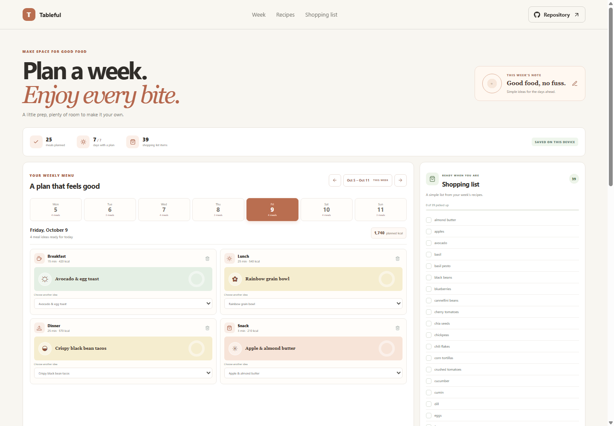

# Tableful: Meal Planner

Tableful helps map meal ideas across a week and turns the planned recipes into a practical shopping list. Keep a day open when you want flexibility, or build a small recipe collection that suits your routine.

**Project repository:** https://github.com/a2rp/meal-planner
**Deployed site:** https://a2rp.github.io/meal-planner/

## What you can do

- Browse the current week and move between weeks or individual days.
- Choose breakfast, lunch, dinner, and snack ideas for each day.
- See the selected day's estimated calories and a count of planned meals.
- Build a weekly shopping list from recipe ingredients and check items off.
- Search and filter the recipe collection by meal type.
- Create recipes with ingredients, meal type, preparation time, and calorie estimates.
- Remove a planned meal or recipe with a confirmation dialog.

## How to use it

Choose a day in the weekly menu, then use a meal selector or the recipe cards to add an idea. Create a recipe to add your own ingredients to the collection. The shopping list updates from the week's planned recipes, and its checkboxes track what you have picked up. Use the week arrows to plan ahead or review an earlier week.

## Data and privacy

Meal plans, recipes, and checked shopping items are stored in local storage in this browser. They are not sent to a server. Clearing this browser's site data removes the saved information. Calorie values are illustrative estimates attached to recipes, not dietary guidance.

## Run and check locally

Install dependencies with `npm install`, then start the Vite development server with `npm run dev`. Run `npm run lint` for ESLint and `npm run build` for a production build. Run `npm run deploy` to publish the `dist` folder to the `gh-pages` branch.

## Future improvements

Ideas only. These are not implemented yet:

- Add serving sizes and editable ingredient quantities.
- Export a shopping list as a printable file.
- Add optional recipe tags and cuisine filters.

## Links

- Portfolio: [https://www.ashishranjan.net](https://www.ashishranjan.net)
- GitHub: [https://github.com/a2rp](https://github.com/a2rp)
- CodePen: [https://codepen.io/ash1198](https://codepen.io/ash1198)
- LinkedIn: [https://www.linkedin.com/in/aashishranjan](https://www.linkedin.com/in/aashishranjan)
- Facebook: [https://www.facebook.com/theash.ashish/](https://www.facebook.com/theash.ashish/)
- YouTube: [https://www.youtube.com/@ashishranjan-ashz?sub_confirmation=1](https://www.youtube.com/@ashishranjan-ashz?sub_confirmation=1)
- Email: [mailto:ash.ranjan09@gmail.com](mailto:ash.ranjan09@gmail.com)

## Support

- Support: [https://a2rp-donation-page.netlify.app/](https://a2rp-donation-page.netlify.app/)
- Buy Me a Coffee: [https://buymeacoffee.com/ashishranjan](https://buymeacoffee.com/ashishranjan)
- Patreon: [https://www.patreon.com/ashishranjan](https://www.patreon.com/ashishranjan)